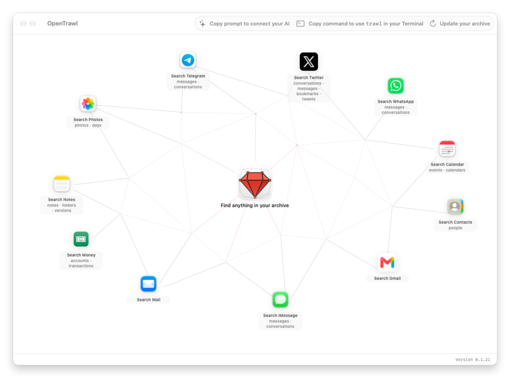
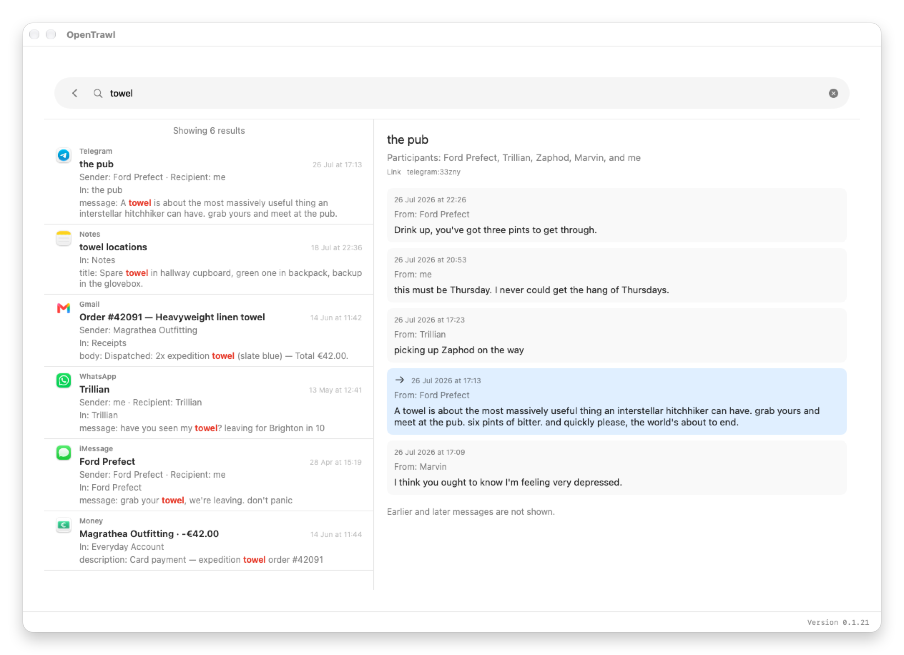

# OpenTrawl

**Spotlight for the Agentic OS.** Give any AI you use searchable access to your messages, emails, notes, photos, calendar, contacts, health, finances, and X history, without handing your life to a cloud vendor.

Your AI does not know your history. Every time you switch models or start a new chat, you re-explain who people are, paste old messages, and dig up receipts yourself.

OpenTrawl fixes that. It keeps a private, searchable archive of your apps on your Mac so any AI you use can answer questions from your real life and link straight back to the original message, email, note, or transaction.

## Get started on Mac

1. **Download [OpenTrawl for Mac](https://github.com/opentrawl/opentrawl/releases/latest/download/OpenTrawl.dmg)** and drag it to Applications.
2. **Open the app and grant Full Disk Access.** Guided setup walks you through turning on Full Disk Access so OpenTrawl can read your local Apple apps, then indexes your archive in the background. Before granting access, you can use the app's built-in audit prompt to have an AI inspect the exact app bundle on your disk. You can also search and read everything directly inside the Mac app window.
3. **Hand it to your AI.** Click **Copy prompt to connect your AI** inside the app and paste it into Claude Code, Codex, OpenClaw, Hermes, or any agent that can run tools.

Or paste this directly into your AI:

> Use my local OpenTrawl archive at `/Applications/OpenTrawl.app/Contents/Helpers/trawl`. Start by running it with no arguments and with `--help`, then run a small read-only search and open one result to show me how it works. Once you have shown me the demo, ask me what I think and whether I want you to use OpenTrawl more often (for example by adding a short instruction to my `AGENTS.md` or setting up a skill). Do not run `update`, install plugins, or change any files or configuration unless I ask.

Your agent inspects `trawl` on its own and starts answering questions with links back to the original records.

## What you can ask your AI

- *"What did I talk to Sam about across iMessage, WhatsApp, Telegram, and Gmail last month?"*
- *"Pull up everything from my trip in September: messages, emails, photos, calendar events, and what I spent."*
- *"Find that note or X bookmark about home insurance. I do not remember the exact words."* (Turn on local topic search on Apple Silicon Macs; it runs privately on your Mac and uses no memory when idle.)
- *"Did I pay that invoice, and which account did it come from?"*

Because your archive stays on your disk in standard SQLite files, you can point Claude, Codex, Gemini, OpenClaw, Hermes, or a local model at the same history anytime.

*Real Mac app render with anonymised example data.*

## What it connects to

### 12 built-in sources

| Source | What OpenTrawl archives | What it needs from you |
| --- | --- | --- |
| [iMessage](trawlers/imessage) | Apple Messages conversations and messages | Full Disk Access (guided setup) |
| [WhatsApp](trawlers/whatsapp) | WhatsApp Desktop chats, groups, messages, and media details | WhatsApp Desktop + Full Disk Access (guided setup) |
| [Telegram](trawlers/telegram) | Telegram for macOS chats and messages | Telegram for macOS + Full Disk Access, or direct QR login (`trawl telegram connect`) |
| [Apple Mail](trawlers/mail) | iCloud Mail and any other account in Apple Mail | Full Disk Access (guided setup) |
| [Notes](trawlers/notes) | Apple Notes folders, notes, attachments, and past versions | Full Disk Access (guided setup) |
| [Contacts](trawlers/contacts) | Apple Contacts and people resolved across your messaging apps | Full Disk Access (guided setup) |
| [Calendar](trawlers/calendar) | Apple Calendar events, calendars, and attendees | Full Disk Access (guided setup) |
| [Photos](trawlers/photos) | Apple Photos dates, places, albums, cameras, people tags, and favourites | Full Disk Access (nearby-place lookups and photo descriptions are not enabled yet) |
| [Apple Health](trawlers/health) | Apple Health exports, HealthFit `.fit` workouts, sleep, daily vitals, and incremental HealthKit batches | Local `export.zip`/`export.xml`, `.fit` files, or dropped HealthKit batches (`trawl health import PATH`; no network) |
| [Gmail](trawlers/gmail) | Your Gmail mailbox (direct from your Mac to Google) | Read-only Google sign-in via your agent (`trawl gmail connect`) |
| [Money](trawlers/money) | Bank accounts, balances, and transactions (ING and Wise) | Your own Enable Banking app registration, or import files written by an agent |
| [Twitter (X)](trawlers/twitter) | Your posts, bookmarks, likes, mentions, and direct messages | Pasted X web session cookies, an exported X archive, or an X API key |

### Plugins for everything else

Want to index an app or export OpenTrawl does not ship with? Paste this into your coding agent:

> Read `https://raw.githubusercontent.com/opentrawl/opentrawl/main/skills/build-trawl-plugin/SKILL.md` and build me a standalone OpenTrawl plugin for [APP OR EXPORT]. Show me every website, folder, and secret it needs and ask for my approval before installing it.

Plugins run in a strict macOS sandbox. You approve the exact folders, websites, and Keychain secrets each plugin may touch, and a plugin can never read another source's archive or browse your home folder.

## Privacy and security

- **Everything stays on your Mac today.** Your archives live in `~/.opentrawl` as plain SQLite files. OpenTrawl runs no servers, requires no account, and collects no telemetry.
- **Read-only by design.** OpenTrawl copies your history so you and your AI can search it. It never sends messages, edits notes, or writes back to your apps.
- **What goes to your AI.** Whatever your agent reads from your archive (including full conversations, notes, or emails you ask it to open) goes to your AI provider under its privacy terms. Your full archive stays on your machine rather than being uploaded upfront.
- **Open source and auditable.** Inspect the code yourself, or use the Mac app's audit prompt to have an AI check the exact app bundle before you grant permissions.

## Where OpenTrawl is going

OpenTrawl runs locally on macOS today. Here is what we are building next so your archive works across every device and every agent:

- **Simpler Mac setup without Full Disk Access:** Connect messaging and cloud apps directly so Full Disk Access becomes an optional toggle only if you want Apple-locked apps like iMessage and Apple Notes.
- **Phone and Linux:** iPhone and Android apps (for Apple Health, mobile photos, contacts, and messaging) plus Linux and Docker support for always-on agent servers.
- **One-click agent connections (MCP):** Connect agents like Claude, Codex, OpenClaw, Hermes, and T3 Code directly and choose which sources each agent can see (for example, let a coding agent search your notes without seeing your bank history).
- **Optional encrypted sync and paid private hosting:** Sync across your Mac, phone, and Linux machines while servers store only data they cannot decrypt, plus optional paid cloud hosting so your phone and cloud agents can search your archive at any hour, encrypted so that we cannot read it.
- **More sources:** Signal and community-maintained plugins.

## The OpenTrawl suite

- **OpenTrawl** (this repo): Spotlight for the Agentic OS. Give any AI searchable access to your messages, emails, notes, photos, calendar, contacts, health, finances, and X history.
- **[Agent Keyring](https://agent-keyring.jjpcodes.com/)**: 1Password for the Agentic OS. Let your AI agents sign in as you anywhere you work, using the passwords you already keep in Apple Passwords, approved on your Mac, iPhone, or Apple Watch.

## For agents and developers

- **Agent CLI & skill:** Run `/Applications/OpenTrawl.app/Contents/Helpers/trawl` with no arguments, `--help`, or `skill` for the complete command reference, bundled `SKILL.md`, and exit codes (`0` complete, `1` failed, `2` bad usage, `3` partial result). Machine-readable site overview: [`https://opentrawl.sh/llms.txt`](https://opentrawl.sh/llms.txt).
- **Build from source:** Install Nix, [devenv](https://devenv.sh), and [direnv](https://direnv.net), then run `direnv allow` and `scripts/dev-bin` (or `app/scripts/dev-run --candidate <name>` for a separate signed `OpenTrawl Dev.app`, and `app/scripts/cold-run --candidate <name>` to reset dev onboarding).
- **Architecture docs:** [Vision](docs/vision.md), [Trawler control contract](docs/contract.md), [Mac app contract](docs/mac-app.md), shared packages in [`trawlkit/`](trawlkit/), and per-source docs under [`trawlers/`](trawlers/).

## Contributing

OpenTrawl is open source (MIT). We keep tight architectural control and **do not accept unsolicited feature or new-source pull requests**. Read [CONTRIBUTING.md](CONTRIBUTING.md) before opening a PR. To add a new source, hand [`skills/build-trawl-plugin/SKILL.md`](skills/build-trawl-plugin/SKILL.md) to your coding agent to build an external plugin, or open an issue.

Read [AGENTS.md](AGENTS.md) before editing this repository. This repo is public: never commit personal archives, real messages, contacts, locations, account identifiers, archive-derived counts, or synthetic archive fixtures. Run `scripts/check-clean` before every commit.

## Licence

MIT; see [LICENSE](LICENSE). Forked source directories retain their upstream licences and copyright notices.
